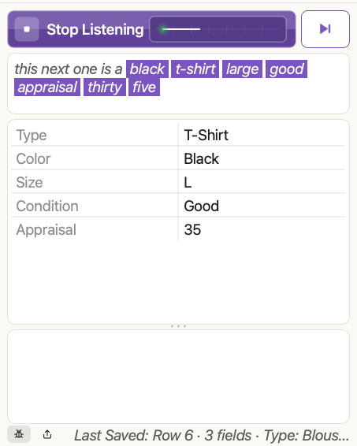

# Quill

**Talk. Quill types.** Quill fills in your spreadsheet row by row while your hands stay busy. Open a spreadsheet, say
"start listening", describe an item, and each word lands in the right column. It works with Excel, Numbers and LibreOffice
Calc, and it learns your vocabulary from your own drop-down lists and column headings, so it suits any catalog: clothing,
plants, parts, coins.

Your voice and your spreadsheets stay on your computer: speech is recognised offline and nothing is uploaded.

## Get Quill

Download the latest version for your computer from the [Releases page](https://github.com/sadmicrowave/quill-dictation-app/releases/latest)
or from the [Quill website](https://quill-website-eta.vercel.app/download.html):

| Your computer | Download |
|---|---|
| Mac with an Apple chip (M1 or newer), macOS 26 or newer | `Quill-mac-apple-silicon.dmg` |
| Mac with an Intel chip, macOS 26 or newer | `Quill-mac-intel.dmg` |
| Windows (64-bit) | `Quill-windows.zip` (open it and run `Quill.exe`) |

**The first time you open it,** your computer will ask you to confirm, because Quill is not signed with a paid developer
certificate (yet). This happens once:

- **Mac:** drag Quill to Applications and open it. If macOS says it can't verify the app, open **System Settings > Privacy &
  Security**, scroll down and press **Open Anyway**.
- **Windows:** if Windows protects your PC, press **More info**, then **Run anyway**.

Then allow the **microphone** when asked (and, on a Mac, **Automation** for your spreadsheet program, which is only how Quill
sees which files are open). There is nothing else to set up.

## Your first row

1. **Open your spreadsheet** in Excel, Numbers or LibreOffice.
2. **Press Start** (the wide button at the top of Quill), or say "start listening".
3. **Describe an item:** *"black t-shirt, large, good condition, appraisal thirty five dollars"*. Your words appear in the
   box under the button, and the matching columns light up in the grid as you speak.
4. **Say "next row"** to save it and begin the next one.
5. **Say "stop listening"** when you are done. If you forget, Quill stops by itself after a few quiet seconds.

Quill only writes while it is listening, so room chatter never lands in your sheet.

## What Quill does

- **Learns your words.** Column names and the values in your drop-down lists become the words Quill listens for, so there
  is no list of commands to memorise.
- **Fills the right column.** Amounts, dates, and list values go where they belong; say a column's name first when a word
  could fit more than one.
- **Shows what it heard.** The words you say appear as you speak, and the row grid under them lists your sheet's columns,
  filling in live so you can catch a mistake before saving the row.
- **Asks about new words.** Something Quill doesn't know goes to the **Term Helper**, where one click (or a spoken answer)
  adds it to the right list or teaches Quill what it means.
- **Fixes mistakes.** Say "undo", remove a wrong line with its small **x**, or change which column a value goes in.
- **Works your way.** Light, dark or automatic themes, adjustable window opacity and blur, a small **mini view** that
  sits over your spreadsheet, and optional confirmation sounds.
- **Stays private.** No accounts, no tracking, no uploads. The only things that ever leave your computer are an optional
  speech-model download, a check for a newer version (which sends nothing about you), and a problem report you choose to
  send.

## Help is built in

Press **F1** (or use **Help > Quill Help**) for the full guide, with pictures: talking to Quill, working with different
spreadsheet programs, the Term Helper, settings, sounds, privacy and troubleshooting. A short guide to what to say is in
[Using Quill](docs/usage.md).

## If something is not working

| What you see | What to try |
|---|---|
| Nothing happens when I speak | Make sure the light is green (press **Start**). Check that Quill is allowed to use the microphone in your computer's privacy settings. |
| "File not connected" | Open a spreadsheet in Excel, Numbers or LibreOffice. Quill notices within a few seconds. |
| "This sheet has no column headings Quill can find" | Click **Headings Row** or **Sheet Layout** in the message (or press the gear beside **Active File**) and tell Quill where the headings are. |
| My drop-down lists are not picked up | Save the spreadsheet. Quill re-reads it by itself within a few seconds. |
| A word is ignored | Say the column's name just before the value, exactly as it is written in the heading. |
| Quill hears itself | Turn off *Read questions aloud* in Settings, or use headphones. |

More in the app under **Help > Troubleshooting**.

## Documentation

| | |
|---|---|
| [Using Quill](docs/usage.md) | What to say, searching, the Term Helper, voice sorting and undo, working with workbooks |
| [The window and settings](docs/interface.md) | The main window, mini view, settings, appearance, sounds, speech models |
| [Development](docs/development.md) | Running from source, tests, building the app, releasing |
| [Architecture](docs/architecture.md) | How the code is organised and how a spoken phrase becomes a row |
| [Development history](docs/development-history.md) | Notes from each phase of the project |

## Tested on

Quill's automated tests run on every push, on these systems: macOS 26 and 15 (Apple chip), macOS 15 (Intel), and Windows
Server 2025 and 2022. The badges at the top show whether the latest run passed. A green **Tests** badge for `main` means the
full set of systems passed.
