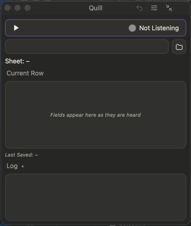

# Welcome to Quill

**Talk. Quill types.** Quill fills your spreadsheet one row at a time while your hands stay busy.

**You need:** a spreadsheet (in Excel, Numbers or LibreOffice, or an `.xlsx` or `.csv` file) and a microphone.

## Where to start

| I want to | Go to |
|---|---|
| Try it for the first time | [Quick start](help:quick-start) |
| Choose or open my spreadsheet | [Choose your spreadsheet](help:choose-spreadsheet) |
| Learn what to say | [Say your first row](help:first-row) |
| Find an icon or button | [Every icon and button](help:icons) |
| Fix something | [Troubleshooting](help:troubleshooting) |

Your voice and your spreadsheets stay on your computer ([Privacy and your data](help:privacy)).

**Next:** [Quick start](help:quick-start)
