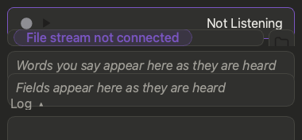

# 📗 Your spreadsheet

Quill works with the spreadsheet app **you already use**. You don't pick one or change any setting.

## 🧩 Supported apps

| App | How Quill works with it | You do |
|---|---|---|
| **Excel** (Mac, Windows) | Live: rows appear as you speak | Nothing |
| **Numbers** | Quill works **in the open document**: rows appear in Numbers as you speak (and are saved to the `.xlsx` too); new sheets, headings and lists kept in cells are seen at once; switching sheets is followed within about a second while you are listening (otherwise with the regular check). A typed drop-down list that gets a new value is changed in the `.xlsx` and Numbers **reopens the file** so its menu shows the value at once (if you typed something in Numbers that the file lacks, Quill does not reopen it and says so). Numbers cannot hide rows, so a search **greys out the rows that do not match** and jumps to the first match; clearing the search puts the colours back | Open an `.xlsx` (for a `.numbers` sheet: **File > Export To > Excel** once). The first time, allow Quill to control Numbers. If Numbers does not answer, Quill works on the file as before |
| **LibreOffice Calc** | Quill works **in the open document**, like Excel: rows appear in LibreOffice as you speak and stay unsaved there until **you save**; new sheets, new headings and new drop-down lists are seen at once; switching sheet tabs is followed within a second | Open an `.xlsx`. Quill adds a small script (`quill_mirror_v…py`) to LibreOffice's user scripts folder the first time (and replaces it when Quill updates it; it is safe to delete). The script keeps a private link to LibreOffice (on your computer only). If the link is not up, Quill works on the saved file as before |
| **Others, Google Drive copies** | Works on the `.xlsx` file | Reopen the file to see new rows |

> 💡 Quill looks for an open sheet every few seconds. Open one at any time and Quill finds it.

## 📁 Using a file directly

No spreadsheet app open? Quill can fill a file by itself.

1. Press the **folder** icon in the title bar, left of the turn and Settings icons. The **side panel** eases in on the right (press the folder again to ease it away). The icon is grey and closed while no file is open, and solid and open once one is; hover it to see the file's name and the open sheet.
2. The panel's **Active File** section is one button: it reads **Open File** (with a folder) until a file is active, then shows the file's name. Press it for the standard file window, which opens where the active file is (or use **File > Open File…**), and pick an `.xlsx` or a `.csv` file. Under it, a small table: Sheet (with a **refresh** icon at its right end: it asks your spreadsheet program which sheet is open now and, if you have moved to another sheet, Quill goes there too; Quill also checks by itself every 10 seconds, and you can change that in **Settings > General > Check for Changes**), Path (one line), Type (Excel, LibreOffice, CSV ...), Size, Modified and Created (MM/DD/YYYY).
   Pressing **Start** with no file open opens the **Files** panel; pressing it again while the panel is open blinks **Open File** green and opens the file window.
   Quill is an overlay for your spreadsheet program: a file you choose is **started in that program first**, and Quill listens and writes to it only while it is open there, so you can watch every row arrive. If it is not open yet, Start says it is waiting.
3. Dictate. Quill remembers the file next time.

A file you pick this way that no program has open yet is **started in its own program** as well (in the background, so Quill stays in front).

### Where the data starts

If the sheet you have open has **no column headings** Quill can find (a blank sheet, say), **Start is off** and says so; see [Troubleshooting](help:troubleshooting) for how to bring it back.

Press the **gear** at the right of **Active File** for the **file settings** (an overlay; the gear is greyed out until a file is connected, and greys out again if the file is let go). These settings belong to the **sheet** you have open, in that workbook: another sheet, or another file, has its own, and Quill remembers each one next time you open that file. They are: **Headings Row** (**Automatic** finds the headings), **Starting Row** (where a turn may begin writing; **Automatic** is the first empty row under the headings), and **Sheet Layout** (**By Columns**: headings run across the first row and each turn writes to the next row; **By Rows**: headings run down the first column and each turn writes to the next column). With **By Rows** these become **Starting Column** and **Headings Column** and are chosen from a list, A to Z.

### Several programs at once

You can have Excel open with one workbook, Numbers with another and LibreOffice with a third. Quill writes only while the active file is open in one of them, and each turn is shown in the program that has that file: switching the active file (in the **Files** panel or with **Open File**) switches where the rows appear, with nothing to set. If the file is open nowhere, Quill opens it for you, once (never a second copy), and **Start** begins listening by itself the moment it is open: you do not press it again.

### Rows appearing live in LibreOffice

It works the same way in **LibreOffice Calc**, through a small script Quill puts in LibreOffice's own user scripts folder (and says so in the log once). Choosing a file with **Open File** also opens it in the program set under **Settings > General > Open Files With** (or your computer's choice), so Quill never works without a program showing the file; the live display itself never starts a program, and Quill never keeps the cells: they are handed over and forgotten. If LibreOffice cannot take them, Quill asks it to load the file again after a quiet moment.

### Rows appearing live in Numbers

While an `.xlsx` is open in **Numbers**, each cell Quill writes to the file is also set in the open Numbers document the moment the turn ends, so you watch the rows arrive and confirm them. Nothing is reloaded, so Numbers does not show its "may look different" warning again. The first time, macOS asks whether Quill may control Numbers: allow it (later: System Settings > Privacy & Security > Automation). Numbers keeps its own copy, so once you have edited, it calls the document *name.numbers*; Quill finds it either way. If Numbers cannot take the rows, Quill falls back to asking it to load the file again after a quiet moment. That reload replaces the open copy (Quill never leaves a second copy of the file open), and if the document has changes you have not saved, Quill leaves it alone and says so once in the Log: close it without saving and open the file again to see what Quill saved.

### When another program holds the file

Quill writes only the cells it fills in, so the results your formulas already show stay as they were and the spreadsheet program does not warn that the file was edited.

If Excel has the file you chose, Quill works through Excel itself (no file to fight over). If a program refuses the save (Excel on Windows), Quill keeps your rows, tries again every few seconds, says so in the **Log**, and after a few tries saves them to *name (Quill copy)* beside the file.

### Spreadsheets that are already open

Under a muted line, the **Open Spreadsheets** section lists, in a scrolling list, the other spreadsheets open in programs on this computer (Excel, Numbers, LibreOffice Calc ...). Each file has a small icon for its program or type (the Excel-style green grid for Excel files, green bars for Numbers files, a white sheet on a teal tile for LibreOffice Calc, and a white page with the file type's letters (CSV, TXT ...) for the rest). The file Quill is working on is listed too: it always stays at the top with the same thin green border an accepted Term Helper row gets, and clicking it changes nothing; click any other one and it becomes the active file. The icon follows the program that has the file open (an `.xlsx` open in LibreOffice shows LibreOffice's icon; the Type line still says it is an Excel file), and a file no program has open gets the icon of its type. The same icon appears before the Type in Active File. If you close the active file's window in your spreadsheet program, Quill notices (at once when you press a refresh icon, otherwise within a minute), stops listening, says so in the log, and goes back to **Open File**; the file then drops out of the list unless it is still open somewhere. A workbook open in Numbers that was imported from an `.xlsx` is listed as well: Numbers only reports such a document by name, so Quill finds the matching file with Spotlight (the newest match outside the Trash). Type in the **Search** box to narrow the list. With nothing open it says *No open spreadsheet files detected.* The list refreshes by itself every 10 seconds (the one check loop, see **Settings > General > Check for Changes**), and the **refresh** icon beside the heading looks again at once (it shows a pressed look, and *No open spreadsheet files detected.* disappears for a moment and returns if nothing is found, so you can see it looked). Typing 3 or more letters in **Search** looks again too. The first time, macOS may ask whether Quill may control Excel: that is only so Quill can see which workbooks are open.

**File > Use the Open Workbook** goes back to the workbook open in your spreadsheet program.

## 📄 Working on a .csv file

A `.csv` file is plain text with no drop-down lists, so Quill learns from the file itself:

- Each column whose entries **repeat** (not numbers, not dates, not long sentences) becomes a list. Its different entries, with duplicates removed, are what Quill matches your words against.
- In a **brand new** file, with only a heading row, every word you say for a text column goes to the **Term Helper** to be sorted. That is how its lists begin.
- **Search is not available** (a `.csv` file cannot be filtered). Saying "search for…" tells you so in the **Log**.
- Rows are added to the end of the file. What was already there is left exactly as it was.

## 📑 Which sheet gets the row

Always the sheet that is **open** (the active tab). Quill never tries another sheet for you. If that sheet doesn't have the columns you filled (a dashboard is in front, say), the row isn't saved: you'll see a red **Error** in the **Log**, which opens by itself. Open the sheet you mean and say **"next row"** again. Your words stay in the grid until the row is saved.

## 🪟 What the window shows

- **File not connected**: said by the **Start** button itself (a grey button with a flat line in its screen) while no sheet is found. Pressing **Start** then opens the **Files** panel so you can pick a file. Hover it for what to do.
- **No columns on this sheet**: said by the **Start** button when the sheet that is open has no column headings Quill can find (a blank sheet, say). **Start is off**: the button is greyed, the *Start Listening* menu item and the voice command do nothing, and nothing you could say would have a column to go to. Hover the button, or read the message in the grid under it: **Headings Row** and **Sheet Layout** in it open the file settings, where you tell Quill where the headings are. If you switch to such a sheet while listening, Quill stops listening and says so in the Log. Start comes back by itself when the open sheet has headings.

- **The box that says "Words you say appear here…"**: the words Quill hears, as you say them. Words it already knows light up as coloured pills.
- **The row grid** under it: as soon as a spreadsheet is connected it lists the active sheet's columns, in the sheet's order and in muted text (they ease in from the top, so you can see Quill is connected to the right sheet). When you say a word that belongs to a column, that column turns to the normal text colour and slides to the top of the grid *as the word is heard*, in the order you said them, and its value appears beside it as a pill (like the words above it) the moment Quill understands it. If the finished phrase is read a little differently (the Careful speech model re-reads each phrase when you pause), the value updates. Columns you have not mentioned stay muted below. Check it before saying "next row", and remove any line that is wrong with its round **x** (shown when you hover a line that has a value). After "next row" the grid goes back to the muted list, in the sheet's order.
- **Last Saved** summary: the row written last, as a muted *Last Saved: Row 7 · 4 Fields*, at the right of the footer (the strip along the bottom of the window); hover it for every field. It only appears after the first save.
- **The footer** holds small icon buttons that all look the same size. The **bug** button opens and closes the **Log**: it gets the same soft grey rounded highlight as the title bar's buttons while the Log is open and is plain when it is closed (the View menu's Log entry does the same, **⌥⌘L**). While the Log is open an **export** button (a tray with an arrow) appears beside the bug: it opens a file chooser, starting in your home folder with the name `quill-system-log-<date>_<time>.txt`, and saves the Log as a text file. The Log is a record of what happened. Each line starts with its time; a long message wraps back to where the message starts, not under the time.

The window opens at the smallest size it can be (and never gets smaller). The mini view remembers its own size; if you close Quill in the mini view, it opens in the mini view again.

## 🔘 The title bar

| Icon | Where | Does |
|---|---|---|
| Question mark | left, beside the window buttons | Opens this help, on the page for where you are |
| Curved arrow | left, next to the question mark | **Undo** the last answer |
| Sliders | right | **Settings** |
| Arrows | far right | **Mini view** |

> 💡 **On Windows** the same icons (help, undo, folder, turn, settings, mini view) sit in a **toolbar of their own above the Start button**, split as on a Mac: help and undo at the left, the folder, turn, settings and mini-view icons at the right. They have no border until the pointer is on one, and a thin line under the row separates it from Start, so Start keeps the whole width. The mini view has no ribbon: its arrows sit beside Start. The **File, Listening, View, Window, Help** menu bar is in the size of the title bar's text.

## 🔔 Menu bar icon

A rounded square: **outline** = idle, **solid** = listening. Open it to start, stop, show the window or quit. While listening it names the sheet being written.
