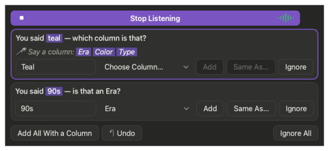

# 🧩 Term Helper

Opens when Quill hears a word it can't place, such as *"…teal, from the 90s…"*.

## 🔔 How you know

- The **Term Helper** button and the badge on the menu bar icon show the count **the moment** Quill hears a word it doesn't know.
- When you finish the row, a **special sound** plays and the **Term Helper** window opens by itself.
- You can answer a word before the row ends: it goes into the row you are saying.

Everything Quill understood is already saved. Term Helper only handles the leftovers.

## 🖱️ Answer with the mouse

The word is already capitalised for you, and whatever you type is capitalised when it is added. For each word choose:

| Button | Means |
|---|---|
| **Add** | New choice in that column's list |
| **Same As…** | Another name for a value you already have ("extra large" = XL) |
| **Ignore** | Forget it |
| **Same As M** *(an example)* | Shown when what you said spells out a short code in the list, like *medium* for **M** or *extra large* for **XL**. One click makes it another name for that code |

The **Choose Column** list opens by itself when Quill needs one.

The Term Helper asks you to do something, so it stays **solid and easy to read** even when the main window is see-through. (To make it fade with the main window, turn on **Term Helper Follows Window Opacity** in [Settings](help:settings).)

## 🎙️ Answer by voice

Press **Start Listening** at the top (or say **"sort terms"**), then talk. Quill answers the **top row** and moves on. The button looks and works like the main window's: a play icon, the sound lines (grey and still before) turn green and move, it reads **Stop Listening**, and a small **Stops in …s** countdown sits beside the icon: stay quiet for the set time and voice sorting ends by itself.

The columns on screen are the context: if you say a word that isn't a column but sounds like one in the list (*"sighs"* for **Size**), Quill picks that column.

| Say | Does |
|---|---|
| **"Yes"** / **"Add"** | add to the suggested column |
| **"Color"** *(a column)* | add to that column |
| **"Same as XL"** | another name for XL |
| **"Ignore"** | forget it |
| **"Later"** | move to the end |
| **"Add all"** / **"Ignore all"** | everything at once: all the rows flash and leave together, then the Term Helper closes and the main window comes back to the front, ready for the next row |

If you press **Start** in the main window while the Term Helper is open, voice sorting ends and what you say goes into the row again; new unknown words join the Term Helper list.
| **"Undo"** | take back the last answer |
| **"Done"** | leave voice sorting |

> 💡 Chain answers: **"yes… same as XL… color… done"**

## ✨ What you'll see

1. If you said a column, it **lights up green in the Choose Column list** (you hear and see that the word was understood).
2. Straight after, the row **blinks**: **green** when the word was added, **grey** when you ignored it, **red** if the answer couldn't be carried out.
3. It **fades and closes**, then the next row moves up.
4. The window **closes** when none are left.

## ↩️ Changed your mind?

Press **Undo** (title bar) or say **"undo"**. Each press takes back one answer, up to your last 100. The word returns to the list and what Quill did is reversed.

> ⚠️ Undo never overwrites something you've typed since.
