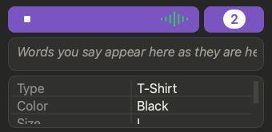

# 🪟 Mini view

A small box that floats over your spreadsheet.

## 🔄 Switch

- Click the **arrows icon** in the title bar to shrink.
- Click it again to get the full window back, exactly as it was.
- Quit while in the mini view and Quill opens in the mini view next time.

## 👀 What stays

- The **Start / Stop** button and its sound lines
- A **Term Helper** badge with the count
- The quiet countdown ("Stops in 7s")

- A red **!** when something went wrong (the Log is hidden here). Hover it to read the message; click it to return to the full window with the **Log** open. It goes away when the next row is saved.

## 🙈 What hides

Log, Last Saved, settings, and (at its compact size) the Voice Stream and row grid.

## 📏 Make it taller

Drag the mini view taller and the **Voice Stream** and row grid appear. Quill remembers the size you left it at, and returns to it the next time you shrink the window.

> 💡 **Settings > General > Keep the Mini View on Top** controls whether it floats above other windows (on by default).
