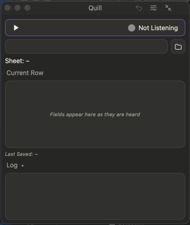

# Say your first row

How to describe an item so Quill fills the right columns.

## Do this

**1. Click Start** .

**2. Say what describes the item,** in any order: *"black t-shirt, large, good, appraisal thirty five"*.

*You'll see:* your words in the box under Start. Words Quill understands become purple pills.

**3. Look at the grid.** Each column you mentioned turns dark, moves to the top and shows its value.

A wrong value? Hover its line and click the round **x**: the line is removed and won't be written.

**4. Say "next row".**

*You'll see:* the row written to your spreadsheet, and the grid reset.

## What the colours mean

| You see | It means |
|---|---|
| A **purple pill** | Quill understood it and put it in a column |
| A **grey pill** in the words | Quill is asking about it (see [the Term Helper](help:term-helper)) |
| A **grey pill** in the grid | A number Quill filled in itself (see [ID and record numbers](help:ids)) |
| **Plain grey words** | Quill did not understand them |

## Ways to say it

| You say | Quill does |
|---|---|
| A value from a drop-down list: *"black"* | Fills the column that list belongs to. |
| The column, then the value: *"size medium"* | Fills that column. Use this when two columns share a value. |
| *"this next one is a..."* | Ignores the filler. |
| Two values for one column: *"jeans and other"* | Keeps both in the cell, one per line. Say the column name to replace instead. |

Words it hears that sound like a column or value are taken as that word (*"waste"* becomes *Waist* if your sheet has a Waist column). The Log says so.

**Next:** [Numbers, money and dates](help:numbers-dates)
