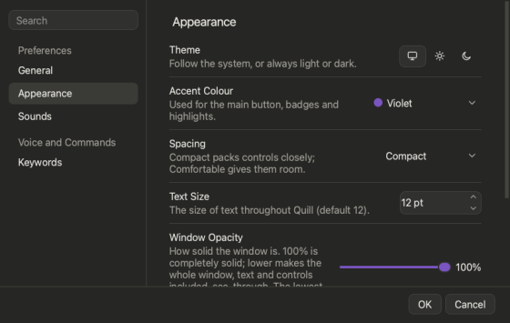
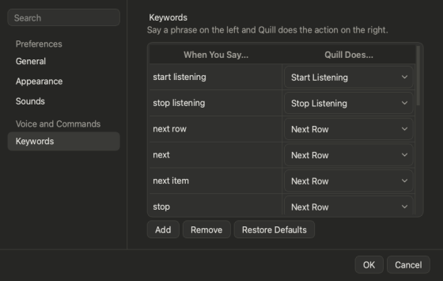

# ⚙️ Settings

Press the ** sliders icon** in the title bar. Type in **Search** to jump to a setting (try *blur* or *voice*).

> 💡 Changes show **live**. **OK** keeps them, **Cancel** puts everything back. Settings reopens on the page you left it on, at the size you left it.

## 🧭 Groups

| Group | What's in it |
|---|---|
| **About** | What Quill is, its version number, the **Check for Updates** button (it reads **Update** when a newer version is out) and the switch for checking at every start |
| **General** | Spoken Term Helper prompts (off by default), automatic voice sorting, microphone, **stop when quiet**, Dock icon, Undo memory |
| **Appearance** | Theme, accent colour, spacing, text size, opacity, blur |
| **Sounds** | Sound set, spoken word, sample |
| **Keywords** | The phrases you say and what they do |
| **Learned Words** | The words you taught Quill to read as a column, how soon it learns them, and **Words To Skip** (words you trimmed off terms in the Term Helper) |

## 🎨 Look

- **Theme:** Auto, Light or Dark
- **Accent:** Violet (default), Terracotta, Ocean, Forest, Rose
- **Spacing:** Compact or Comfortable
- **Text size:** 9–20 pt
- **Term Helper Follows Window Opacity** (off by default): the Term Helper stays solid so it is easy to read; turn this on to make it see-through like the main window
- **Opacity & blur:** drag a slider, or click anywhere along it to jump there. **Opacity** thins the window's background and, by the same amount, the fills of text boxes, drop-downs, buttons and cards in every window (text and borders stay crisp); the title bar thins and blurs the same as the rest; Settings itself never goes below 25 % so the slider stays easy to find; **Blur** then blurs what shows through it (0 keeps it sharp). At opacity 100 the window is solid whatever the blur

## 🗝️ Keywords

Edit, add or remove phrases. Quill won't let a phrase clash with *yes* or *no*, and always keeps one for **Start** and **Stop**.

## 🎙️ Microphone

- **Stop Listening When Quiet** (on by default): if nothing is said for **10 seconds**, listening stops by itself, so the microphone is never left open by accident. While it counts down, the seconds left (for example **7s**) show at the right end of the button's screen, and a green ring around the stop icon empties with them (the Term Helper's voice button does the same). Say anything and it starts again from the full time. Change the seconds (3 to 3600) or turn it off in **General**. It also ends voice sorting and a wait for a spoken answer; the questions stay on the **Term Helper** list for later.

- **Off** until you press Start, and off again when you stop.
- Want to say **"start listening"**? Turn on **Keep the Microphone Open When Not Listening**. Your Mac's orange mic dot will show.

## 🧑‍🏫 Learned words

**Settings > Learned Words** (under *Voice and Commands*) holds what you taught Quill (see **Teaching Quill your words** in *Talking to Quill*).

- **Corrections Before Learning** (2 by default, 1 to 5): how many times you change a word to the same column before Quill uses it on its own. Saying *"spotted means observation date"* counts at once.
- **Ask Before Learning** (on by default): Quill asks before remembering a column change. Off: changes are counted without asking.
- **The list** shows each word, the column it means, the file it was learned in, its status (*Taught*, *In use*, *Learning (1 of 2)*) and how often it was used. Search it, switch between **All Files** and **This File**, group it by file or column, and choose the group order (**Most Recent First**, **Name A–Z**, **Most Words First**). Click a heading to sort inside each group; click again to reverse.
- **Forget Selected** and **Forget All Shown** remove words. More than one always asks first; **Cancel** is the default. This can't be undone.
- The **Learned Words** link under the active file in the Files panel opens this page on **This File**.

### Check for Changes

**Settings > General > Check for Changes** is how often (5 to 600 seconds, 10 by default) Quill looks at your spreadsheet programs. It is one short check that does three things: it lists the files that are open (the Available Files list), notices when the file Quill is working on was closed (Quill lets go of it, stops listening and goes back to **Open File**), and asks which sheet is open, so rows go to the sheet you are on. Nothing is started for this: if no spreadsheet program is running, the check only looks at the list of running programs. The refresh icons in the Files panel, and pressing **Start**, check at once.

### Open Files With

**Settings > General > Open Files With** chooses the program Quill opens a spreadsheet in when you pick one that is not open yet: *Automatic* (what your computer opens that kind of file with), Numbers, LibreOffice or Excel. Every program is listed; the ones not installed on this computer are grey and last. Text Size defaults to 14. Numbers and LibreOffice show each row as Quill writes it; Excel is updated in place.

## 🧠 Speech model

It runs **on your computer**: nothing is sent online. A model is **installed once** (over https, checked against a fingerprint) and then works without an internet connection. **Settings > Speech Model** (under *Voice and Commands*) lists the models with a radio button each; only one can be chosen, and the one in use is selected. Each shows its download size (in italics, muted) and, in muted text under it, what it costs on a typical laptop (older computers are slower): **Quick** (40 MB, the base model: it ships with Quill and the others build on it) uses ~165 MB of memory and shows your words as you say them. **Broad** (130 MB) has a much bigger vocabulary, so unusual words, names and numbers are heard correctly far more often; it uses ~415 MB (+250 MB) and words can trail by ~1 s (+1s). **Careful** (145 MB) adds a second listen: each time you pause, the phrase you just spoke is re-read by a second model that uses the words around each one, and its corrected words replace the live ones ~.5 s later (Pause + .5s), not at the end of the whole turn; it uses ~700 MB (+535 MB). A model that is not on this computer has an **Install** button with progress; one that is has an **Uninstall** button, so the buttons alone say which are installed. A model you install becomes the one in use. **Uninstall** deletes the model and gives the disk space back (it is greyed out for Quick, the base model, and its hover text says so). The model can also be changed at any time from **Turn Options > Speech Model**, which takes effect straight away, with no restart and no file reload; choosing one that is not installed opens this page.

Each model's description names the model underneath, so you can look it up: **Quick** uses the Vosk model `vosk-model-small-en-us-0.15`, **Broad** the Vosk model `vosk-model-en-us-0.22-lgraph`, and **Careful** adds OpenAI's Whisper `base.en`, run with faster-whisper (`Systran/faster-whisper-base.en`).

## 🖥️ Dock and menu bar

Quill lives in both. Hide the Dock icon in **General**, then use the menu bar icon > **Open Quill**. Closing the window never quits Quill: use **Quit** in the menu bar menu.

## 🍎 The menu bar

Everything Quill does is also in its menus: the menu bar at the top of the screen on a Mac, and the window's own menu bar on Windows.

| Menu | What's in it |
|---|---|
| **File** | Open File… (**⌘O**), Use the Open Workbook, Check for Open Files Now (**⌘R**), Settings… (**⌘,**; on a Mac it sits under *Quill*), Quit (**⌘Q**; *Exit* on Windows) |
| **Listening** | Start / Stop Listening (**⌘L**), Next Row (**⌘↩**), Start a New Row, Undo (**⌘Z**), Term Helper… (**⇧⌘T**, shows its count), and the turn choice: each turn a new row, or each turn adds to the same row |
| **View** | Switch to Mini View / the Full Window (**⇧⌘M**), Files Panel (**⇧⌘F**), Turn Options Panel (**⇧⌘O**), Log (**⌥⌘L**), and Settings Page to open any Settings page directly |
| **Window** | Minimize (**⌘M**), Bring Quill to the Front |
| **Help** | Quill Help (**F1**), Report a Problem…, Privacy and Your Data, Open the Log Folder, About Quill (opens **Settings > About**) |

Entries that do not apply are greyed out (Next Row while not listening, Undo with nothing to take back, Term Helper with nothing to sort), and the wording and check marks follow what Quill is doing. On a Mac the same menus show while Settings, the Term Helper or Help is in front. On Windows, use **Ctrl** where a Mac uses **⌘** and **Alt** for **⌥**.
