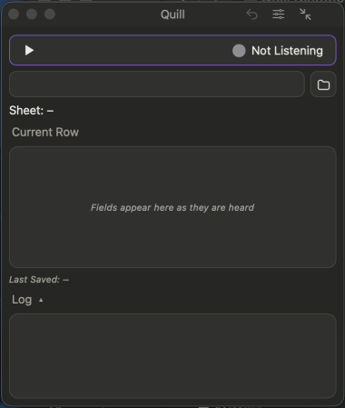

# Notes and long text

For a **Notes**, **Comments** or **Description** column: say as much as you like, pauses included.

## Do this

**1. Say "notes"** (the column's name) **or "start note".**

*You'll see:* the notes line light up in the grid.

**2. Speak your note.** Pause whenever you need to.

*You'll see:* the words gather in the cell as you speak.

**3. Say "end note" or "next row".**

*You'll see:* the note finished with a capital letter and a full stop.

## The info icon

A small  next to a column name tells you how that column works. Rest the pointer on it: on a note column it reads *"Say “notes” or “start note”, speak your note, then “end note” or “next row”."*

## Good to know

Inside a note, column names and list values are just words, so *"the price went up last spring"* stays in the note.

A note also ends when you start a phrase with another column's name: *"color navy"* after a pause.

## If something looks off

| You see | Do this |
|---|---|
| The note stopped early | You began a phrase with a column name. Say **"start note"** and continue. |
| Words landed in the wrong column | Say **"start note"** first, so everything after it is the note. |
| Nothing is in the note | Say **"cancel"** to start the row again. |

**Next:** [ID and record numbers](help:ids)
