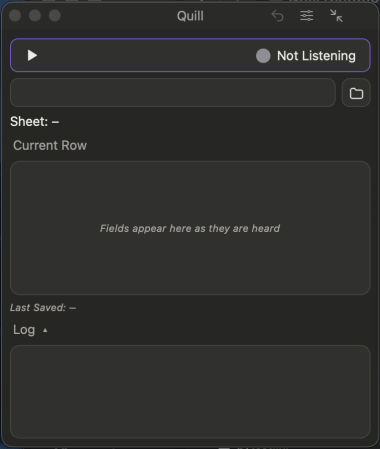

# ID and record numbers

If a column counts up by one (41, 42, 43), Quill fills in the next number for you.

## How it works

**1. Open a sheet whose ID column already has at least three numbers in a row.** Plain numbers (41, 42, 43) and numbers with text around them (A-0041, A-0042, A-0043) both work.

**2. Click Start** .

*You'll see:* the next number in a **grey pill** in the grid, after the columns you have said, with an  next to the name.

**3. Say your row as usual and say "next row".**

*You'll see:* the number saved with the row, and the next number ready.

## Use your own number

**Say a value for the column** (*"id fifty seven"*) and yours is used. Or hover the grey line and click the round **x** to leave that row's cell empty.

## Good to know

Quill reads your sheet, not the heading, so it works for *ID*, *Record Number*, *Invoice* or any name. It checks the column again just before saving, so a row added meanwhile isn't numbered twice.

Quill never writes over a cell that already has something (a formula, say). Columns with a drop-down list, notes, dates, formulas or numbers that skip are not counted.

## If something looks off

| You see | Do this |
|---|---|
| A number appears in a column that only looks like counting (a quantity: 1, 2, 3) | Click the round **x**, or say a value. |
| No grey number at all | The column needs three numbers in a row at the end, and Append To mode off. |

**Next:** [Fix a mistake](help:fix-mistake)
