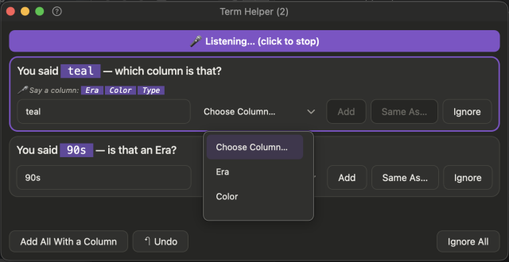

# Term Helper by mouse

When Quill hears a word it can't place (such as *"teal"* or *"the 90s"*), it collects it here. Everything Quill did understand is already saved.

## Do this

**1. Say your row and "next row".**

*You'll see:* a special sound, and the **Term Helper** window opens. (The button and the menu bar icon show a count as soon as a word is heard.)

**2. Trim the words that aren't part of the value.** If Quill heard *"ones teal"*, change it to *"teal"*.

When you **Add** it, Quill skips the words you cut from then on.

**3. Click a button for each word.**

| Button | Means |
|---|---|
| **Add** | A new choice in that column's list |
| **Same As…** | Another name for a value you already have (*"extra large"* = **XL**) |
| **Ignore** | Forget it |
| **Same As M** *(an example)* | One click: what you said spells out a short code in the list |

**4. Or answer them all:** **Add All With a Column** and **Ignore All**.

*You'll see:* the row blink green (added), grey (ignored) or red (couldn't be done), fade, and the next one move up. The window closes when none are left.

## Good to know

In the words you said, a word Quill is waiting on has a **grey pill**. When you answer, it turns **purple** (added) or goes back to plain text (ignored).

Pick the column from the **Choose Column** list; it opens by itself when Quill needs one.

The window opens at the bottom left. Move it once and Quill remembers the place.

## If something looks off

| You see | Do this |
|---|---|
| The same word keeps coming back | Click **Add** or **Same As…** once. Quill remembers. |
| You answered wrongly | Click **Undo** . Up to 100 answers can be taken back. |

**Next:** [Answer by voice](help:term-helper-voice)
