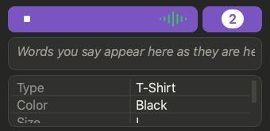

# Mini view

A small window that floats over your spreadsheet.

## Do this

**1. Click the mini-view icon**  in the toolbar.

*You'll see:* the window shrink. The toolbar stays where it is, with Start below it.

**2. Click it again** to get the full window back, exactly as it was.

## What stays and what hides

| Stays | Hides |
|---|---|
| The toolbar and the **Start** button | The Log and Last Saved |
| The **Term Helper** badge with its count | The Voice Stream and the grid (until you drag the window taller) |
| The countdown ring | |
| A red **!** when something went wrong | |

Clicking the folder or turn icon in the mini view brings the full window back and opens that panel.

## Good to know

Drag the mini view taller and the Voice Stream and grid appear. Quill remembers the size.

The mini view floats above other windows. Turn that off in **Settings > General > Keep the Mini View on Top**.

Quit while in the mini view and Quill opens in it next time.

## If something looks off

| You see | Do this |
|---|---|
| A red **!** next to Start | Hover it to read the message, or click it to return to the full window with the Log open. It goes away when the next row is saved. |

**Next:** [Add to one row, or rows down](help:turns)
