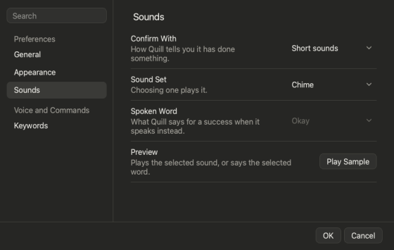

# Sounds

Short sounds tell you what happened, so your eyes can stay on your hands.

## What each sound means

| Sound | Means |
|---|---|
| **Bright rising chirp** | Saved cleanly, or added, or searched |
| **Three rising notes** | Some words need sorting |
| **Soft falling blip** | Ignored, undone or deleted |
| **Low buzz** | A problem, or not understood |

Sounds play only for things you **say**. A click confirms itself on screen and stays silent.

## Change them

**1. Open Settings**  and choose **Sounds**.

**2. Pick a sound set,** a spoken word (*Okay*, *Done*, *Got it*), or **Off**.

*You'll see:* the sound play straight away.

## Spoken guidance

Off by default. Turn on **Speak Sort Term Prompts** in **Settings > General** to have a voice tell you what to do for each Term Helper word (*"Which column is that? Say Color, Size, or ignore, or later."*). Answer **"yes"** or **"no"** as usual.

Quill uses spoken words nowhere else. With speakers on, Quill may hear itself: use headphones, or leave this off.

## Good to know

**Sounds for Term Helper Actions** (on) controls the sound when a word is added, matched or ignored. Turn it off to keep the Term Helper quiet while the rest of Quill still confirms rows.

**Next:** [Every spoken phrase](help:phrases)
