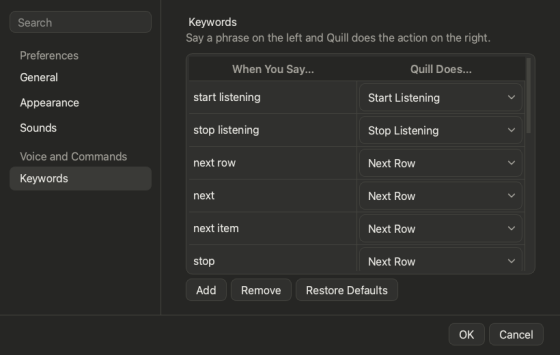

# Every spoken phrase

All the phrases Quill listens for, in one place. Change any of them in **Settings > Keywords**.

## Listening and rows

| Say | Does |
|---|---|
| **"Start listening"** | Opens the gate: Quill starts taking speech |
| **"Stop listening"** | Closes the gate |
| **"Next row"**, *"new record"*, *"next"*, *"next item"*, *"stop"* | Saves the row and starts the next. *Next*, *next item* and *stop* count only as the last words you say. |
| **"Delete row"** or **"cancel"** | Drops the row you are still describing |
| **"Undo"** | Takes back the last Term Helper answer |

## Notes

| Say | Does |
|---|---|
| The column's name (*"notes"*) or **"start note"** | Begins a long note |
| **"End note"** | Ends it |

## Search

| Say | Does |
|---|---|
| **"Search for..."** | Filters the sheet |
| **"Clear search"** or **"reset filters"** | Shows every row |

## Term Helper

| Say | Does |
|---|---|
| **"Sort terms"** | Starts answering by voice |
| **"Open term helper"** or **"term helper"** | Opens the window |

## Turn options

| Say | Does |
|---|---|
| **"Append on"** or **"append mode"** | Every turn adds to the same row |
| **"Append off"** or **"row mode"** | Every turn is a new row |
| **"Rows down"** | Headings run down the first column |
| **"Columns across"** | Headings run across the first row |

## Good to know

A phrase can't be a bare *yes* or *no*, duplicates are refused, and Start and Stop each keep at least one phrase. **Restore Defaults** in Settings > Keywords brings back any you removed.

**Next:** [Every icon and button](help:icons)
