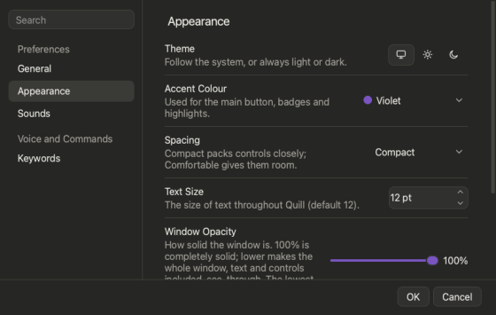

# Settings

Everything you can change, one group at a time.

## Open it

**1. Click Settings**  in the toolbar.

**2. Type in Search** to jump to a setting (try *blur* or *voice*).

*You'll see:* changes show live. **OK** keeps them; **Cancel** puts everything back. Settings reopens on the page and size you left.

## The groups

| Group | What is in it |
|---|---|
| **About** | Version, **Check for Updates** (reads **Update** when one is out), the start-up check |
| **General** | Spoken Term Helper prompts, automatic voice sorting, microphone, stop when quiet, Dock icon, undo memory, **Check for Changes**, **Open Files With** |
| **Appearance** | Theme (Auto, Light, Dark), accent colour, spacing, text size (9 to 20), opacity and blur |
| **Sounds** | Sound set or spoken word ([Sounds](help:sounds)) |
| **Keywords** | The phrases you say ([Every spoken phrase](help:phrases)) |
| **Speech Model** | Quick, Broad, Careful; **Reduce Background Noise**; **Focus On Answers While Sorting** |
| **Learned Words** | Words you taught Quill ([Teach Quill your words](help:teach-words)) |
| **Words To Skip** | Words Quill leaves out of new values: add, search and remove them |

## Good to know

**Opacity** thins the windows and the fills inside them; text and borders stay crisp. **Blur** blurs what shows through. Settings never goes below 25 % opacity so the slider stays easy to find.

**Check for Changes** (5 to 600 seconds, 10 by default) is how often Quill looks at your spreadsheet programs. Numbers is checked more often while you listen.

**Open Files With** chooses the program Quill opens a file in: Automatic, Numbers, LibreOffice or Excel.

The Mac's **Dock icon** can be hidden in **General**; use the menu bar icon > **Open Quill**. Closing the window never quits Quill.

**Next:** [Menus and shortcuts](help:menus)
